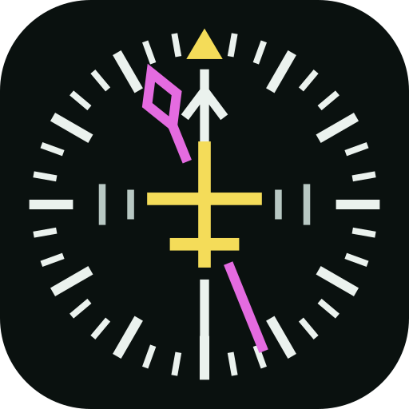

# Location Bridge

[简体中文](README.zh-CN.md)



Location Bridge is an experimental Android-to-iPad location bridge. An Android helper collects and checks location samples; a Termux-hosted Python worker uses `pymobiledevice3` to send latitude and longitude to an iPad through its developer location simulation service. The helper also displays location and motion information in a compact instrument-style interface.

**Research and testing only. Do not rely on this project for safety-critical decisions.** Simulated location can affect other apps on the iPad. A clear command may fail if the connection is lost; verify that the iPad has returned to its normal location state after testing.

Version 0.4.0 introduces an [experimental adaptive positioning core](docs/public/adaptive-core.md). Device checks confirmed native location, GNSS diagnostics and authenticated Termux snapshots; moving end-to-end validation is still pending.

Version 0.4.1 adds [helper-to-Termux launch controls](docs/public/app-launch.md); USB startup from the app has been confirmed on OPPO K12s, with location received on an iPad.

Version 0.4.2 adds a vector launcher icon inspired by a standby navigation display, without text. It includes a monochrome layer for themed icons.

Version 0.5.0 adds ground speed in km/h and kts, continuous INS fallback, and an INS position/correction display. See the [adaptive core notes](docs/public/adaptive-core.md) for source priority and validity requirements.

Version 0.5.1 refines the English display with concise aviation-style labels, POS/INS monitor pages and explicit action keys. `INS EPU` means the model's estimated position uncertainty; its confidence level has not been calibrated. `LAST POS Δ` is the time-aligned pre-correction INS−GNSS difference. These are distinct quantities. [Display terminology](docs/public/display-terms.md)

In 0.5.2 the instrument tabs stay visible as you scroll. The INS can replay a delayed GNSS fix against two seconds of motion history at sensor rates up to 200 Hz. The link display gives a newer bridge report precedence over an earlier launch command, including after the report expires.

In 0.5.3 the INS page groups position and calibration data in five fixed rows. The altitude label includes its WGS84 datum, with metres and feet displayed together. After pairing, the key fingerprint is available under **SETUP → TERMUX PAIRING**.

In 0.6.0 **CONNECT** selects USB or Wi-Fi at startup. Wi-Fi can use the phone hotspot when the paired iPad joins it. The INS page shows its state once and keeps four fixed rows for readings.

## Status and limits

- Fixed points and simulated tracks have been observed on an iPad over Wi-Fi and USB. The tested USB path does not require a LAN. Continuous real-world movement through the full Android-to-iPad path has not yet been validated; long-duration and lock-screen operation remain unverified.
- The current iPad DVT simulation call sends **latitude and longitude only**. Altitude, accuracy, ground speed, true/magnetic track and magnetic variation are helper-side display or metadata; they are not delivered to the iPad by this path.
- The experimental GNSS-assisted inertial estimate has no elapsed-time cutoff. It is used only when no measured position remains usable, and still requires an initial GNSS anchor and uninterrupted valid motion data. Model uncertainty grows without an automatic accuracy cutoff; it is not measured drift or an integrity guarantee.
- Fusion mode first uses a valid measured Android location (GNSS, fused or network). An eligible, timestamped BLE fix can take over before INS. Manual deselection and the static TXT gate also apply to transmission. BLE accuracy stays unknown when it cannot be matched to that fix.
- The helper can switch between English and 简体中文 in **SETUP → Language / 语言**. The preference persists without stopping the service.
- `GS` is ground speed; `ALT` is altitude; `TRK TRUE` and `TRK MAG` are movement tracks relative to true and magnetic north; `MAG VAR` is magnetic variation. Track is the direction of motion, not device heading. Android altitude is WGS84 ellipsoid height, not pressure altitude or mean-sea-level elevation.

## Repository and development

- `android/helper/`: native Android location helper and Java tests (Android 12 / API 31 or newer).
- `android/repo/`: Termux service, source selection, pairing and Python worker scripts.
- `tests/`: Python unit tests; `scripts/`: development, runtime preparation and release checks.
- [Development and operating notes](docs/public/development.md) · [Contributing](CONTRIBUTING.md) · [Third-party notices](THIRD_PARTY_NOTICES.md)

Run the offline unit tests with Python 3 and a JDK:

```sh
python3 scripts/run_tests.py
```

The Android build requires a local Android SDK, build tools and JDK; see the development notes. This source release does not include prebuilt APKs, SDKs, wheels, container images or device-specific pairing records. The runtime can be prepared locally, but device pairing and installation still require manual setup; see the development notes.

## License

Copyright 2026 Location Bridge contributors. Original project contributions are licensed under [GNU General Public License v3.0 or later](LICENSE). Dependencies have their own licenses; in particular, the Python worker imports GPL-3.0-or-later `pymobiledevice3`. See [third-party notices](THIRD_PARTY_NOTICES.md) before distributing a combined runtime.
